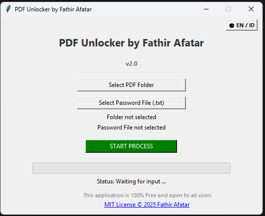
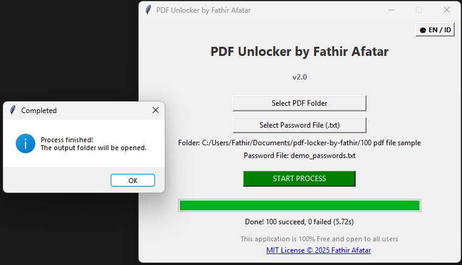
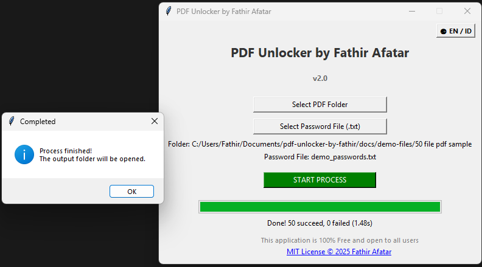
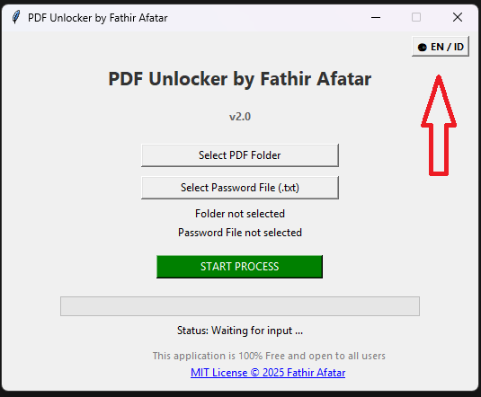
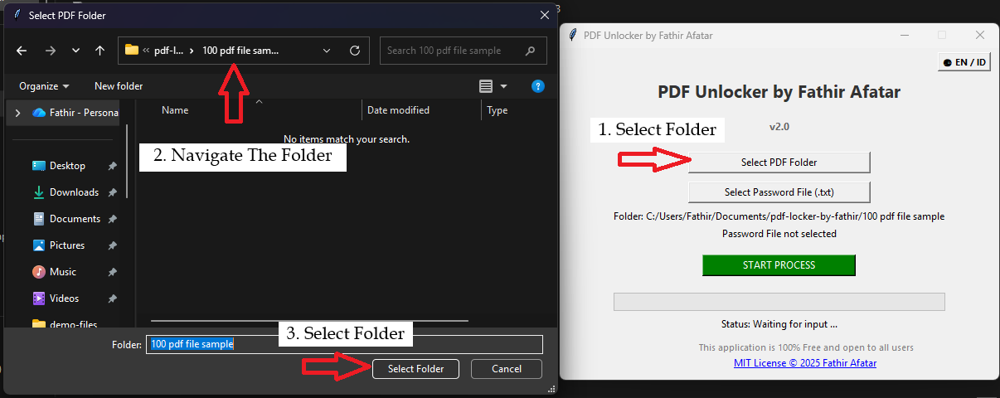
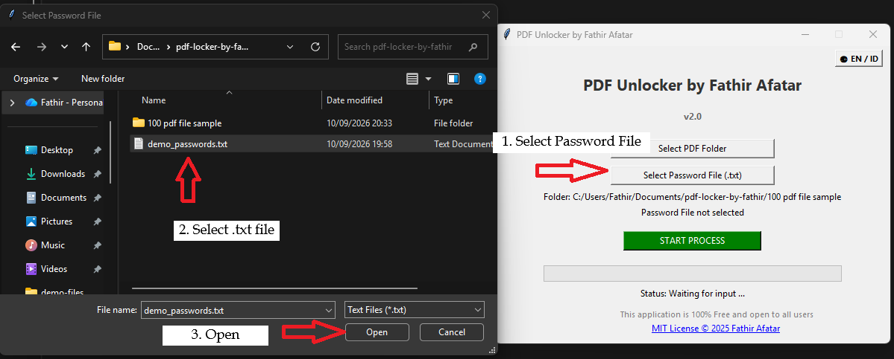

# PDF Unlocker


> Created by **Fathir Afatar**

A lightweight desktop application born out of a real-world workplace need—designed to streamline and automate the process of unlocking password-protected PDF files.

---
## 📸 Preview



## 📌 Overview

**PDF Unlocker** is a simple yet efficient Python GUI tool built with Tkinter. It allows users to batch-unlock multiple PDF files at once using a wordlist of known passwords, replacing tedious manual password entry with a automated workflow.

---

## ⚡ Performance Comparison

Processing password-protected PDFs manually vs. automated batch unlocking:

| Metric | Manual Method | PDF Unlocker (Automated) |
| :--- | :--- | :--- |
| **Time (1 Files)**| ~15 seconds| **<1 seconds**|  
| **Time (50 Files)** | ~12+ minutes (exhausting & prone to errors) | **< 2 seconds** |
| **Time (100 Files)** | ~25+ minutes (exhausting & prone to errors) | **< 6 seconds** |
| **User Effort** | High (manual copy-pasting for each file) | **Low (One-click operation)** |
| **Accuracy** | Prone to human error / typos | **100% Automated matching** |


> *100 files only takes time around **5.72** seconds*


> *50 files only takes time around **1.48** seconds*

> *Note: Actual speed depends on system specs and length of the password list.*

---

## ✨ Key Features

- **Batch Processing:** Unlock dozens of encrypted PDFs in a single click.
- **Wordlist Support:** Import custom password lists via standard `.txt` files.
- **Lightweight GUI:** Clean, intuitive interface powered by Tkinter with zero heavy external dependencies.
- **Privacy-First:** Operates 100% offline—your documents and passwords never leave your machine.

---

## ⚠️ Important Disclaimer & Legal Use

- **Legitimate Use Only:** This tool is designed strictly for authorized users who already know or possess the required passwords (e.g., company archives, personal records).
- **No Brute-Force/Hacking:** This software **does NOT** perform illegal password cracking, brute-forcing, or recovery of lost passwords.
- **Supported Format:** Strictly supports `.pdf` dan `.txt` files only.

---

## Current Limitations
- Supported file format is limited to `.pdf` (Does not support `.docx`, `.xlsx`, `.rar`, `etc.`).
- Requires passwords to be present in the provided `.txt` list.

---

## 📁 Repository Structure

```text
├── src/               # Main Python source files
├── requirements.txt   # Required Python libraries
├── LICENSE            # Open-source MIT License
└── README.md          # Project documentation

```

# Installation Guide

## Requirements

- Python 3.11 or newer
- Internet Connection (optional)
- OS : Windows 10/11 (recommended)

>Note: This GUI uses Tkinter, which is included in the standard Python installation.

# How to Use PDF Unlocker by Fathir
This step using the v.2.0 version.

**Using the Relase version**

---
1. **Choose Language on top right corner [Indonesia (IN) or English (EN)] (Default = IN)

---

2. Click the **Select PDF Folder** button to select the locked PDF file.


---

3. Click the **Select Password File (.txt)** file, a Notepad file containing a list of passwords.


---

4. Click the **"Start Process"** button.


---

5. If successful, there is a new folder opened `unlocked_pdfs `and the PDF file will be saved again without the password.

> *Success dialog and also the stats*


> *A new folder will open, and all the successfully opened PDFs will be inside it.*

---
or

1. **Clone This Repository**

```bash
git clone https://github.com/Fathir-Afatar/pdf-unlocker-by-Fathir-Afatar.git
```
2. **Navigate to source folder**

```bash
cd pdf-unlocker-by-fathir/src
```

3. **Run.** (For testing)
```bash
python pdf_unlocker_gui.py
```

## Tips:
- Use a password list in a `.txt` file that corresponds to the sequence of the PDF files.
- Avoid naming the output file the same as the input PDF to prevent overwriting.

# Changelog

Format : [Version] - Date

## [v2.0] - 2026-08-31

### Added

- Indonesian and English

## [v1.1] - 2025-06-23

### Added

- Basic GUI interface for automatically unlocking multiple PDF files
- Inputs for the PDF folder, password file ('.txt'), and output folder for unlocked files
- Password checking and matching process for each PDF file
- Notifications for unlock status: success or failure
- README.md, LICENSE (MIT), and requirements.txt files
- MIT license information included in the project

## 📄 License
This project is open-source and available under the [MIT License](./License). You are free to use, modify, and distribute it, provided proper credit is given original author: Fathir Afatar.

## Contributing & Contact

Contributions, suggestions, and feature request are welcome!
- Report bugs or submit pull request on the [GitHub Repository](https://github.com/Fathir-Afatar/pdf-unlocker-by-fathir)

- If you find this project helful, please consider giving a ⭐ on GitHub! 